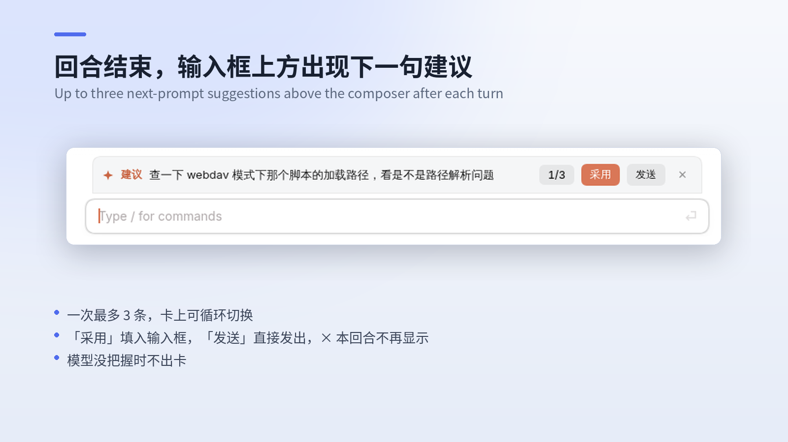
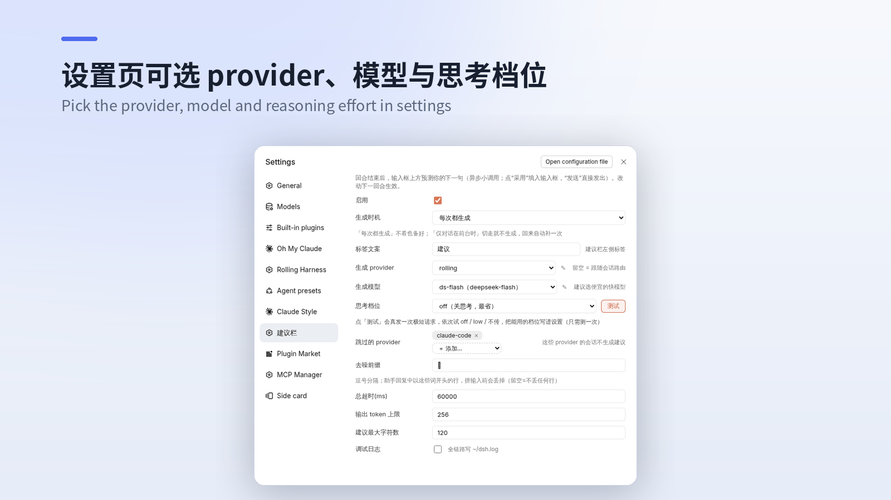

# dsh-plugin-suggest-bar —— 输入框上方「建议」栏

回合结束后，用一次异步小调用预测用户接下来可能说的话（**最多 3 条，卡上可循环切换**），显示在输入框上方；点「采用」**另起一行追加**进输入框、该条从卡片移除、剩下的继续留着（可以连着采纳几条），「发送」直接发出、✕ 本回合不再弹。模型没把握时输出 `NONE`，本回合不出卡。两段式体验（回复先到手、建议异步补弹）在**所有 dsh 会话**的补齐实现（对自带建议能力的会话，默认跳过）。





## 和同类插件怎么选

dsh 插件列表里还有两个做同一件事的插件。下表按**各自仓库里的实现**核对，不是按各自主页自述；三个都能装、都能用，差别在取舍。

|  | 本插件 | ChuanTianML/prompt-for-me | FurinaLiF/dsh-tab-complete |
|---|---|---|---|
| 一次调用产出几条候选 | **最多 3 条** | 1 条 | 1 条 |
| 换一条的代价 | 本地翻页，**不重新调模型** | 重新请求模型 | 没有备选可换 |
| 采用方式 | 点「采用」填入 | 点 ✓ / Tab / → 填入 | **只能 Tab** |
| 直接发出 | 点「发送」 | 不代发（设计如此） | 不代发 |
| 手机端 | 采用/发送/关闭都能点 | 能点 ✓ 和 ✦ | **用不了**（没有 Tab 键） |
| 思考档位 | 可选，且能「测试」探测支持哪档 | 写死 `off` | 无 |
| 与原生建议撞车 | `skipProviders` 可跳过 | 无 | 无 |
| 代码量 | 61.7 KB / 1283 行 | 108.6 KB / 2665 行 | **25.5 KB / 548 行** |
| 测试 | 49 条（host 行为 35 + client 接线契约 9 + 调试轮转 5）；渲染/交互未覆盖 | 5 个测试文件（含 client） | 2 个测试文件（含 client） |
| 分发 | GitHub 源码 | GitHub Release tarball + npm | GitHub 源码 |

### 我们不如它们的地方

- **client 侧只测了接线契约。** 卡片渲染、打字折叠、1/3 轮播、点击这些行为仍靠手测——那层要真 React + DOM，本次刻意没引入。
- **比 tab-complete 重 2.4 倍。** 如果只要「灰字补全 + Tab 填入」这一个功能，那个更合适。
- **「发送」是取舍，不是纯优点。** 两个竞品都刻意不代发（prompt-for-me 明写 never sends a message automatically）。我们少一步确认，也少一道保险。
- **交互细节没 prompt-for-me 细。** 它有 Esc 关闭、清空草稿自动复现、把跳过的候选回喂给模型避免重复；这些我们没做。
- **它发了 npm 包和预构建 tarball**，装的时候不用等构建。

### 我们确实更强的地方

- **一次调用给 3 条，翻页不花钱。** 卡上一次显示一条（`1/3` 按钮切换），想换个说法不用再等一轮模型；竞品换一条要重新请求。
- **手机上能完整操作。** 采用、发送、关闭全是点击；tab-complete 依赖 Tab 键，手机上根本没有这个键。
- **思考档位可选并带探测。** 点「测试」真发一次极短请求，把该模型能用的档位写进配置，只测一次，省输出 token。
- **`skipProviders`。** 会话主模型属于指定 provider（默认 `claude-code`）时不生成，避免和会话自带的建议功能重复出卡。

## 文件清单

| 文件 | 作用 |
|---|---|
| `index.js` | host 侧：监听 `session/event`（turn/end→fire-and-forget 生成；turn/start→作废旧建议）、注册表（落盘 suggestions.json）、三条 HTTP 路由、config.json 读写 |
| `client.js` | 浏览器侧：`conversation.input.dock` 槽渲染建议卡（打字折叠/清空展开）、`settings.section` 槽渲染设置面板、700ms 轮询 |
| `cordis.patch.yml` | bundle 行 + **首启种子配置**（此后以 config.json 为准） |
| `package.json` | `dsh.bundle` / `dsh.client` 声明、peer 依赖 |
| `config.json` | **运行配置**（首启自动从种子生成；设置面板改的就是它） |

## 架构（两段式）

```
回合结束(turn/end completed)
  → host: 有界辅助 LLM 调用（输入=最近几条用户消息（2 条 × 80 字）+ 本轮用户 + 助手回复去噪后按预算截取（头 500 / 尾 1800）+ **本轮最后一步工具调用的真实成败** / 输出 1–3 行各≤120字，`NONE`=不出卡 / 思考档位：设置里测过就直接用，否则按模型能力自动取最省一档，兜底 off→low→不传）
  → 按行解析成 1–3 条 → 存注册表（会话id → {turn, texts[]}），500ms 防抖落盘 suggestions.json（最多 200 个会话）
  → 浏览器每 700ms POST /api/suggest-bar 读取
  → 输入框上方渲染建议卡（跑动中/打字中/已关闭 → 折叠）
用户发消息(turn/start)
  → 旧建议立即作废 + 中止在途生成
```

## 生成路由

- 路由候选：**config.json 配置的 provider+model 优先**（在设置面板里选），失败回退**继承会话当前路由**
- `skipProviders`（默认 `[claude-code]`）：会话主模型属于这些 provider 时不生成（这些会话通常自带原生建议，避免双份）

## 路由（connection.fetch）

| 路由 | 方法 | 用途 |
|---|---|---|
| `/api/suggest-bar` | POST `{sessionId}` | 读当前建议（回合运行中返回 null） |
| `/api/suggest-bar/config` | POST（空体=读，带字段=合并写） | 设置面板读写 config.json |
| `/api/suggest-bar/options` | POST | 枚举 `llm.listProviders()`/`listModels()`（设置下拉） |

## 设置（dsh 设置页 → 「建议栏」节）

provider（下拉识别）/ 模型（下拉联动）/ 标签文案 / **思考档位**（自动探测 ｜ off ｜ low ｜ 不传，旁边有「测试」按钮：真发一次极短请求，依次试 off / low / 不传，把该模型能用的档位写进配置，只需测一次）/ 跳过的 provider / **生成时机**（每次都生成 ｜ 仅对话在前台时，切走不生成、回来自动补一次）/ 总超时 / 输出 token 上限（默认 512，够放 3 条长建议）/ 每条建议最大字符数 / 启用 / 调试日志。**改动下一回合生效**（每回合现读 config.json）。

**去噪前缀**（`stripLinePrefixes`，手改 config.json）：助手回复里以这些字符串开头的行，在拼输入前丢掉。默认 `[]`，即不丢任何行。如果你的记忆或上下文系统会在回复中插入引用标记行，把那一行开头的固定字符串填进来，就能省下输入预算。

## 命中率（这个插件准不准，用真实数据说话）

每回合生成建议后，插件会在用户真正发出下一条消息时结算一次：

- **exact**：用户发的内容与某条建议完全一致（点了「采用」或「发送」就是这个）
- **prefix**：一方是另一方的前缀 —— 采用后又改了几个字
- **miss**：出了建议但用户说了别的

结果按行追加到插件目录的 `feedback.jsonl`（最多保留最近 500 次），设置页「命中率」一行显示汇总，含「第 1/2/3 条分别命中多少次」——用来判断排序对不对。

**只写本机文件，不上报任何地方。** 记录里只留用户消息的长度和前 40 字，不留完整对话。

## 已知特性与限制

- 生成延迟取决于设置面板所选的 provider/模型；生成在回合结束后异步进行，不阻塞主对话
- 建议持久化在插件目录 `suggestions.json`，host 重启后恢复（刻意不写会话日志——自定义事件类型会让宿主事件校验拒载整本日志）
- 打字时建议卡折叠（0.35s 动画），清空草稿自动展开；✕ 只对本回合生效
- **采纳不等于收起**：点「采用」只把那条写进输入框并从卡片移除，卡片继续留着；只有你自己动手打字才折叠。三条全部采纳完，卡片自然消失；清空草稿会把三条都放回来
- 连点「采用」不会覆盖前面的内容（第二次点击时草稿可能还没落定，内部用「上次写进去的值」做基准）

## 测试

```sh
npm install   # 只装 devDependencies（@deepseek-ai/dsh-llm / schemastery），跑测试用
npm test
```

分三层，除 host 侧要装两个官方包外都不需要额外依赖：

- **host 侧 35 条**：假装一个 ctx → 发会话事件 → 读路由返回什么。断言的都是外部能观察到的结果（路由返回、`llm.stream` 有没有被调用、落盘文件内容），不贴内部实现。
- **client 侧 9 条**：用假 `react` 把 `client.js` 求值出来，验证与宿主客户端的接线契约——`__ModuleLoader__` 形态、导出的 `apply`/`inject`、注册了哪两个槽位及其 `id`/`order`、没有 `sessionId` 时不渲染。**这一层不渲染组件**，所以测不到渲染和交互。
- **调试轮转 5 条**：真写一个 2 MB 文件，验证超限时轮转成 `debug.log.1`、旧内容完整保留、只留一代；以及关掉调试后 stdout 一个字节都不写。

假 `react` 的 hooks 被设计成「一旦被调用就抛错」，防止组件体在求值阶段被意外执行时测试还静悄悄通过。

数据目录默认就是插件目录；测试会把 `SUGGEST_BAR_DATA_DIR` 指到临时目录，所以不会读到也不会写坏真实的 `config.json` / `suggestions.json`。

client 侧（浏览器）还没有测试，目前靠手测。

## 排障

设置面板打开「调试日志」→ 复现一轮 → 看插件目录的 `debug.log`。全链路探针（事件→转录→路由→每次尝试的耗时/失败原因→输入由哪几段组成→解析出的条数与文本）都在。收工后记得关回去——**关掉之后 stdout 和文件都不再写**，完全安静。

`debug.log` 超过 2 MB 会轮转成 `debug.log.1`（只留一代，再轮转时覆盖上一份），不会无限长，也不会把历史直接清空。

## 版本

- v0.5.4 修并发会话串扰：一个会话的 `turn/start` 不再清掉别的会话在途的工具名映射
- v0.5.3 调试日志改为真轮转（`debug.log` → `debug.log.1`，不再直接清空）；`console.log` 也收进调试开关，关掉后彻底不写
- v0.5.2 修设置页三个数字框（总超时 / 输出上限 / 最大字符数）改不动——受控 input 漏了 onChange，React 当只读处理；该 bug 自 v0.4.0 起存在
- v0.5.1 「采用」改为另起一行追加、采纳后卡片保留、可连续采纳多条；只有手动打字才折叠
- v0.5.0 把本轮最后一步的工具成败喂给模型；历史从 3×150 收到 2×80；同一回合只生成一次；输出上限默认 512（防第三条被截）；新增命中率统计（`feedback.jsonl` + 设置页展示）
- v0.4.2 补测试：host 行为 21 条 + client 接线契约 9 条（`npm test`，零额外依赖）；数据目录支持 `SUGGEST_BAR_DATA_DIR` 覆盖，测试不再碰真实 config.json / suggestions.json
- v0.4.1 修 `@deepseek-ai/dsh-llm` 的 peer 范围：原 `>=0.2.0-rc.2` 按 semver 预发布规则只匹配 0.2.0-rc.2，装到 0.2.1/0.2.2 的预发布宿主上会被解析成旧版本；改为显式 `||` 分支覆盖 0.2.x
- v0.4.0 自管 config.json + settings.section 设置面板 + provider/模型下拉识别；标签默认「建议」（动态下发，零硬编码）
- v0.3.0 dock 槽流式布局 + 主题自适应卡片（主题变量/底角方半径/折叠动画）
- v0.2.x volatile 配置实验（表单在这台 0.2.2 上不出现，已弃用）
- v0.1.x 首版：overlay 槽 + 手动绝对定位（渲染异常，已弃用）
